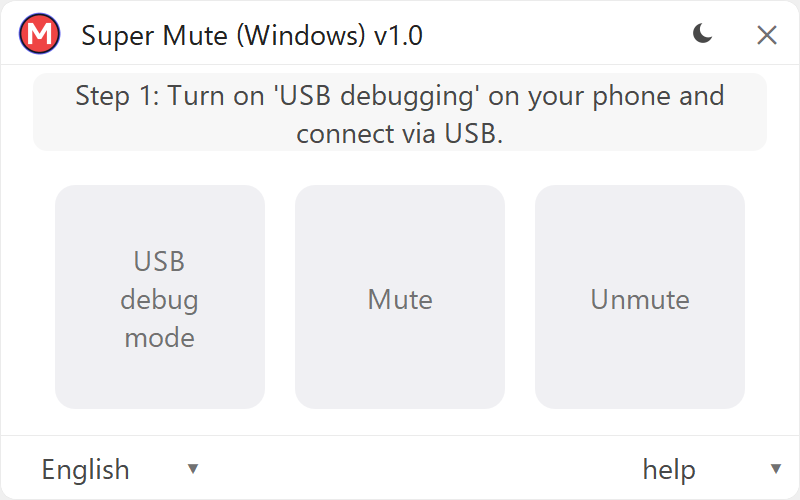
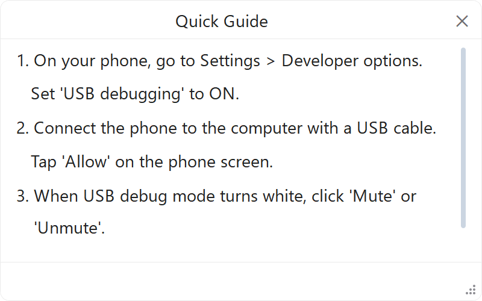

  <a href="README.md">한국어</a> | <b>English</b> | <a href="README_jap.md">日本語</a> | <a href="README_zh.md">中文</a>

# Super Mute (Windows)

  <picture>
    <source media="(prefers-color-scheme: dark)" srcset="logo/minagy_monogram_coral.png">
    <source media="(prefers-color-scheme: light)" srcset="logo/minagy_monogram.png">
    
  </picture>

  <b>1-Click Portable Samsung Galaxy Camera Shutter Silencer for Windows</b> 
  Built by <b>Minagy Labs</b>

  
  
  
  
  
  
  
  
  

  
  &nbsp;&nbsp;
  

---

## Introduction

**Super Mute (Windows)** is a portable Windows utility that safely disables the forced camera shutter sound on Samsung Galaxy smartphones sold in regional regulatory markets (South Korea and Japan).

* **Native Camera Quality**: Works inside the official Samsung Camera app (full HDR, Night Mode, and optical zoom) without screen-capture workarounds.
* **Universal Android Compatibility**: Unlike older workarounds (such as SetEdit) blocked on recent Android versions, Super Mute works across Galaxy devices from Android 7.0 up through Android 16 (One UI 8.5) and upcoming One UI 9.
* **Zero Knox Trip (`0x0`)**: No rooting or bootloader flashing required; Samsung Pay, Samsung Pass, Secure Folder, and banking apps remain fully functional.
* **Silent Mode Sync**: Shutter is silent only when the phone is set to Vibrate or Mute mode.

---

## Download

| File | Platform | Size | Type | Download Link |
| :--- | :--- | :---: | :---: | :--- |
| **`SuperMute.exe`** | Windows 10 / 11 (64-bit) | ~55 MB | Standalone Portable | [**Download Latest Release**](https://github.com/minagylabs/SuperMuteWindows/releases/latest) |

> **No Installation Required**: Super Mute (Windows) is fully self-contained as a single portable executable. With embedded fonts and device communication modules, it runs immediately without installation or Windows registry clutter.

---

## Security & The 10-Second Rule

To protect your device and privacy, please follow these safety practices:

1. **Pre-Scan Your PC**:
   - Run Windows Defender or your chosen anti-virus scanner before connecting your phone.
2. **Execute 1-Click Action**:
   - Connect your phone via USB cable, authorize debugging on your phone screen, and click **Mute**.
3. **Follow the 10-Second Rule**:
   * Disconnect the USB cable immediately after the status shows `Camera Shutter: Muted (0) ✓`.
   * Open phone **Settings > Developer options**, and turn **USB debugging OFF**.
4. **Minimal Scope & Privacy**:
   * The tool queries and modifies only a single camera shutter system setting.
   * It never installs APKs, background services, daemons, or modified files on your smartphone.
   * On exit, it immediately and safely terminates all communication sessions and ports.

---

## Step-by-Step User Guide

1. On your phone, go to **Settings > Developer options**. Turn **USB debugging** ON.  
   *(If Developer options is hidden: Go to **Settings > About phone > Software information**, and tap **Build number** 7 times rapidly).*
2. Connect your phone to your computer with a USB cable.
3. Tap **Allow** when the "Allow USB debugging?" prompt appears on your phone screen.
4. Launch `SuperMute.exe`. When the **Mute** button turns white, click it.
5. Confirm the status card displays: `Camera Shutter: Muted (0) ✓`.
6. Disconnect the USB cable and turn **USB debugging OFF** immediately.

---

## Compatibility Matrix

| Device Series | Target OS | Compatibility | Behavior After Muting |
| :--- | :--- | :---: | :--- |
| **Galaxy S Series** (S7 and newer) | One UI 1.0 ~ 8.5 / 9+ (Android 7 ~ 16+) | **Supported ✓** | Silent when phone is in Vibrate or Mute mode. |
| **Galaxy Z Series** (All Fold & Flip models) | One UI 1.1 ~ 8.5 / 9+ (Android 9 ~ 16+) | **Supported ✓** | Silent on both cover and main cameras. |
| **Galaxy Note Series** (Note 8 ~ Note 20 series) | One UI 1.0 ~ 4.1 (Android 7 ~ 12) | **Supported ✓** | Silent in Vibrate or Mute mode. |
| **Galaxy A / M / Quantum Series** (A10 ~ A55, M series) | One UI / One UI Core (Android 7 ~ 16+) | **Supported ✓** | Silent in Vibrate or Mute mode. |
| **Google Pixel / Xiaomi / iPhone** | Non-Samsung OS | Not Supported | These devices do not use Samsung's native system setting architecture. |

---

## Frequently Asked Questions (FAQ)

<b>Q: Does this work on the latest Android 16 and One UI 8.5 / 9? (Advantage over other tools)</b>

 
<b>Yes, all Galaxy devices are supported regardless of Android or One UI version.</b> 
Legacy workarounds and database editing apps (such as SetEdit or older camera tools) were completely blocked starting with Android 14 due to strict system permission lockdowns. In contrast, <b>Super Mute (Windows)</b> operates independently of internal OS permission restrictions, functioning reliably from older Android 7.0 (Nougat) phones up through the latest Android 16 (One UI 8.5) and upcoming One UI 9 flagships.

<b>Q: Do I need to run this tool every time I restart my phone?</b>

 
<b>No.</b> The setting persists through regular restarts and battery run-outs. You only need to run this tool again if you perform a major annual Android OS version upgrade (e.g., One UI 8.5 to One UI 9) or a factory data reset.

<b>Q: The tool says "Waiting for device...", but my phone is plugged in.</b>

 
Check the following:
1. Ensure your cable supports <b>data transfer</b>, not just charging.
2. Ensure <b>USB debugging</b> is enabled in phone Developer options.
3. Unlock your phone screen and look for the popup prompt: <b>"Allow USB debugging?"</b>. Tap <b>Allow</b> (or check <i>"Always allow from this computer"</i>).
4. If Samsung USB drivers are missing on your PC, Windows Update usually installs them automatically. Alternatively, install Samsung Smart Switch or the official Samsung Android USB Driver.

<b>Q: Why does Windows SmartScreen or anti-virus show a warning on first launch?</b>

 
<code>SuperMute.exe</code> is a brand-new open-source utility built with Python, containing a self-contained USB device communication module. Because it is distributed free of charge without an expensive commercial Extended Validation (EV) code-signing certificate, Windows SmartScreen flags newly released binaries until they build up reputation. The tool contains no malicious code whatsoever and is safe to use.

---

## Support Minagy Labs

Super Mute (Windows) is a free, open-source tool developed and maintained by **Minagy Labs**. It contains zero advertisements and collects no personal data.

If this tool was helpful to you, please consider supporting development:

  

* **Buy Me a Coffee**: [buymeacoffee.com/minagylabs](https://buymeacoffee.com/minagylabs)
* **Instagram**: [@minagylabs](https://www.instagram.com/minagylabs/)
* **GitHub Issues**: [minagylabs/SuperMuteWindows/issues](https://github.com/minagylabs/SuperMuteWindows/issues)
* **Email**: `minagylabs@gmail.com`

---

## License & Credits

* **Software**: Released under the [MIT License](LICENSE).
* **Copyright**: Copyright © 2026 **Minagy Labs**. All rights reserved.
