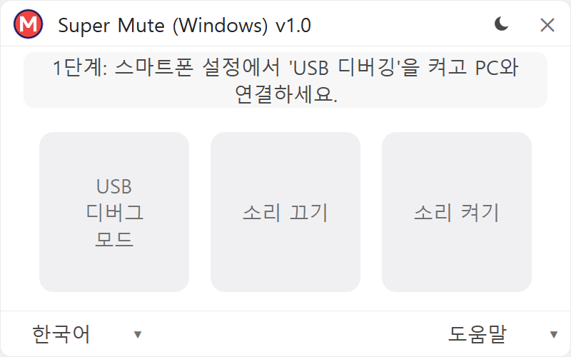
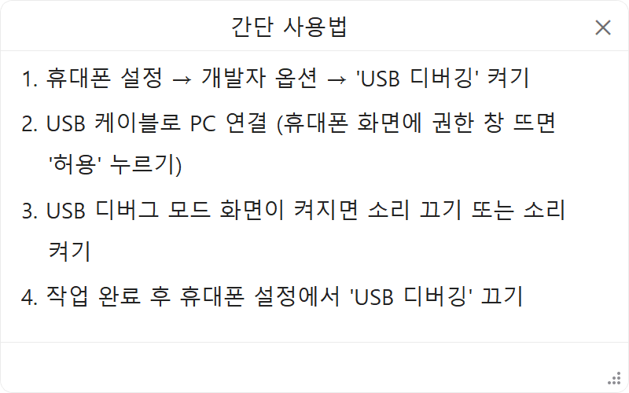

  <a href="README.md">한국어</a> | <a href="README_en.md">English</a> | <b>日本語</b>

# Super Mute (Windows) — スーパーミュート (Windows)

  

  <b>Galaxy カメラシャッター音 1クリック消音 Windows ポータブルユーティリティ</b> 
  Built by <b>Minagy Labs</b>

  
  
  
  
  
  
  
  
  

  
  &nbsp;&nbsp;
  

---

## はじめに

**Super Mute (Windows)** は、日本および韓国の規制・標準化により強制設定されている Samsung Galaxy スマートフォンのカメラシャッター音を、PCから1クリックで安全に消音化する Windows ポータブルツールです。

* **純正カメラの高画質を維持**: 画面キャプチャ型の低画質消音カメラアプリとは異なり、Samsung純正カメラのセンサー画質、ナイトモード、光学望遠ズーム、HDRをそのまま利用できます。
* **Android全バージョン対応**: Android 14以降のセキュリティ強化で無効化された従来アプリ（SetEdit等）とは異なり、最新のAndroid 16（One UI 8.5）や登場予定のOne UI 9まで、OSバージョンを問わず旧型から最新Galaxyまで安定して動作します。
* **Knox保証無傷 (`0x0`)**: ルート化やROM焼きは一切不要。端末のKnoxカウンターを損なわないため、Samsung Pay、Galaxy Pass、セキュリティフォルダ、各種銀行・認証アプリが安全に動作します。
* **マナーモード連動**: 通常の着信音モードでは通常通り音が鳴り、**マナーモード（バイブまたは消音）設定時のみシャッター音が消音**されます。

---

## ダウンロード

| ファイル名 | 対応OS | サイズ | 形式 | ダウンロード |
| :--- | :--- | :---: | :---: | :--- |
| **`SuperMute.exe`** | Windows 10 / 11 (64-bit) | 約55 MB | 単一ポータブル（インストール不要） | [**最新リリースをダウンロード**](https://github.com/minagylabs/SuperMuteWindows/releases/latest) |

> **インストール不要の単一ファイル**: ダウンロード後すぐに実行できるポータブル仕様です。専用フォントと通信モジュールが内蔵されており、PCのレジストリを汚しません。

---

## セキュリティと「10秒ルール」

端末のセキュリティと個人情報を保護するため、以下の安全手順を守ってご使用ください:

1. **PCの事前ウイルススキャン**:
   - スマホをPCに接続する前に、Windows Defender などのセキュリティソフトでPCをスキャンします。
2. **1クリック実行**:
   - USBケーブルでスマホを接続し、画面のデバッグ許可をタップした後、**「消音」** ボタンをクリックします。
3. **10秒ルールの遵守**:
   * ステータスが `シャッター音: 消音 (0) ✓` に切り替わったら、直ちにUSBケーブルを取り外します。
   * スマホの **設定 → 開発者向けオプション** で **「USBデバッグ」を直ちにOFF** にします。
4. **最小権限の保証**:
   * 本ツールはカメラシャッター音に関するシステム設定値1項目のみを安全に参照・変更します。
   * スマホに不要なアプリ(APK)やバックグラウンド常駐プログラムを一切インストールしません。プログラム終了時には通信セッションを直ちに安全に遮断します。

---

## 使い方手順

1. スマホの **設定 → 開発者向けオプション** で **「USBデバッグ」** をONにします。  
   *(開発者向けオプションが表示されていない場合: **設定 → 端末情報 → ソフトウェア情報** の **「ビルド番号」** を7回連続タップしてください)。*
2. USBケーブルでスマホをPCに接続します。
3. スマホ画面に **「USBデバッグを許可しますか？」** と表示されたら **「許可」** をタップします。
4. PCで `SuperMute.exe` を起動し、**「消音」** ボタンが白く点灯したらクリックします。
5. ステータスカードが `シャッター音: 消音 (0) ✓` に切り替わったことを確認します。
6. USBケーブルを取り外し、スマホの設定で **「USBデバッグ」を直ちにOFF** にします。

---

## 対応機種一覧

| 機種シリーズ | 対象OS | 対応状況 | 適用後の動作 |
| :--- | :--- | :---: | :--- |
| **Galaxy S シリーズ** (S7 〜 S24 / S25 / S26) | One UI 1.0 〜 8.5 / 9+ (Android 7 〜 16+) | **対応 ✓** | マナーモード（バイブまたは消音）時に純正カメラが消音 |
| **Galaxy Z シリーズ** (Fold 1〜8, Flip 1〜8) | One UI 1.1 〜 8.5 / 9+ (Android 9 〜 16+) | **対応 ✓** | カバー画面およびメインカメラの双方で消音適用 |
| **Galaxy Note シリーズ** (Note 8 〜 Note 20 Ultra) | One UI 1.0 〜 4.1 (Android 7 〜 12) | **対応 ✓** | マナーモード時に消音 |
| **Galaxy A / M / Feel シリーズ** (A10 〜 A55, M, Feel等) | One UI / One UI Core (Android 7 〜 16+) | **対応 ✓** | マナーモード時に消音 |
| **Google Pixel / Xiaomi / iPhone** | 他社製OS | 非対応 | Samsung純正のシステム設定方式を使用していないため非対応です。 |

---

## よくある質問 (FAQ)

<b>Q: 最新のAndroid 16およびOne UI 8.5 / 9でも動作しますか？（他社方式との違い）</b>

 
<b>はい、AndroidやOne UIのバージョンに関わらず、すべてのGalaxy端末に対応しています。</b> 
従来の設定変更アプリ（SetEdit等）や古い消音ツールは、Android 14以降のセキュリティ強化により権限が完全にブロックされ、動作しなくなりました。一方、<b>Super Mute (Windows)</b> はこうしたOS内部の権限制限の影響を受けないため、Android 7.0（Nougat）を搭載した旧型端末から、最新のAndroid 16（One UI 8.5）、および今後登場するOne UI 9フラッグシップ端末まで、安定して消音化が可能です。

<b>Q: スマホを再起動するたびに再設定が必要ですか？</b>

 
<b>不要です。</b> 通常の再起動やバッテリー切れで電源が落ちても、消音設定は保持されます。年1回の大規模OSアップデート（例: One UI 8.5 → One UI 9）や端末の初期化を行った場合のみ、再度PCに接続して設定してください。

<b>Q: ケーブルを接続しても「接続待機中...」から進みません。</b>

 
以下の項目をご確認ください:
1. お使いのUSBケーブルが充電専用ではなく、<b>データ転送対応ケーブル</b>であることを確認してください。
2. スマホの <b>開発者向けオプション</b> で <b>「USBデバッグ」</b> がONになっているか確認してください。
3. スマホ画面を点灯させ、<b>「USBデバッグを許可しますか？」</b> のポップアップで <b>「許可」</b> をタップしてください。
4. PCにGalaxy用USBドライバがインストールされていない場合は、Samsung Smart Switchまたは公式USBドライバをPCにインストールしてください。

<b>Q: Windows SmartScreen やウイルス対策ソフトの警告が表示されます。</b>

 
<code>SuperMute.exe</code> はUSB端末通信モジュールを内蔵した単一ポータブル実行ファイルです。高額な商用企業署名(EV証明書)を取得していない無償のオープンソースツールであるため、公開初期にはWindowsの評価フィルターによって警告が表示される場合があります。悪意のある挙動は一切含まれていませんのでご安心ください。

---

## 開発者へのサポート

Super Mute (Windows) は、**Minagy Labs** が無償で提供しているオープンソースツールです。広告や有料プランはありません。

日常の撮影やお仕事で役立ちましたら、ぜひ開発の継続をサポートしてください:

  

* **Buy Me a Coffee**: [buymeacoffee.com/minagylabs](https://buymeacoffee.com/minagylabs)
* **Instagram**: [@minagylabs](https://www.instagram.com/minagylabs/)
* **GitHub Issues**: [minagylabs/SuperMuteWindows/issues](https://github.com/minagylabs/SuperMuteWindows/issues)
* **Email**: `minagylabs@gmail.com`

---

## ライセンスとクレジット

* **Software**: Released under the [MIT License](LICENSE).
* **Copyright**: Copyright © 2026 **Minagy Labs**. All rights reserved.
