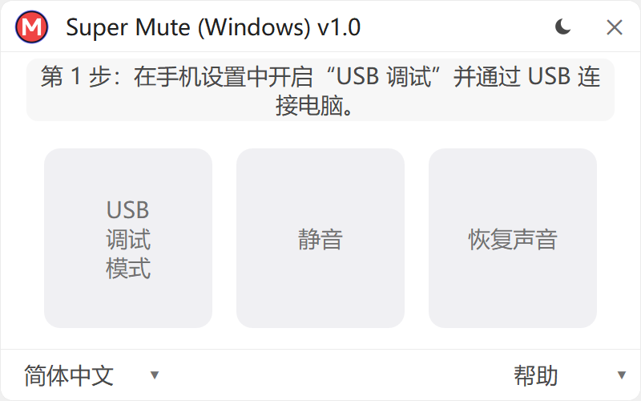
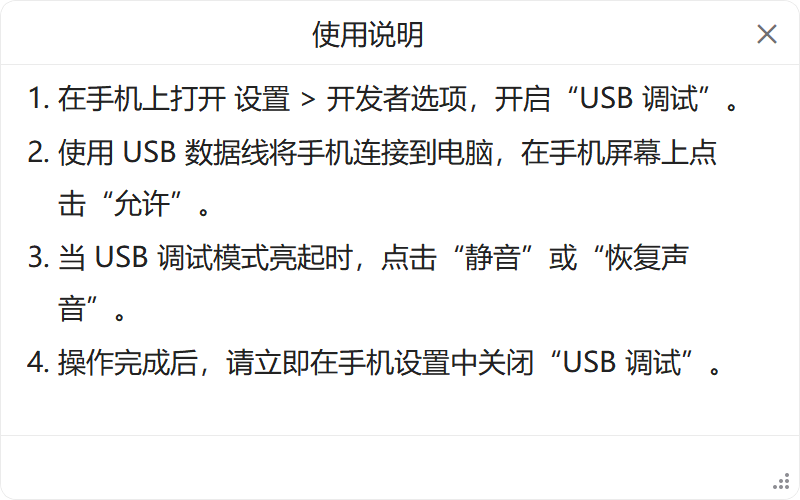

  <a href="README.md">한국어</a> | <a href="README_en.md">English</a> | <a href="README_jap.md">日本語</a> | <b>中文</b>

# Super Mute (Windows) — 超级静音 Windows 版

  <picture>
    <source media="(prefers-color-scheme: dark)" srcset="logo/minagy_monogram_coral.png">
    <source media="(prefers-color-scheme: light)" srcset="logo/minagy_monogram.png">
    
  </picture>

  <b>三星 Galaxy 相机快门音 1 键静音 Windows 便携工具</b> 
  Built by <b>Minagy Labs</b>

  
  
  
  
  
  
  
  
  

  
  &nbsp;&nbsp;
  

---

## 介绍

**Super Mute (Windows)** 是一款免安装便携桌面工具，专为安全关闭三星 Galaxy 智能手机（如韩版、日版等受当地法规约束的机型）中被强制开启的相机快门音而设计。

* **保持原生相机全画质**: 不同于录屏截屏类的低画质静音相机应用，直接在三星原生相机内生效，完美保留完整传感器画质、夜景模式、光学长焦变焦及 HDR。
* **全安卓版本兼容**: 区别于因安卓 14 权限收紧而失效的旧工具（如 SetEdit 等），本工具不受内部系统权限封锁影响，全面支持从 Android 7.0 (Nougat) 到最新的 Android 16 (One UI 8.5) 以及即将发布的 One UI 9 旗舰机型。
* **Knox 状态完好 (`0x0`)**: 无需 Root 或刷写自制固件，绝不熔断 Knox 计数器，Samsung Pay、Samsung Pass、安全文件夹及各类银行软件均正常运行。
* **振动/静音模式联动**: 在常规响铃模式下保留快门声音，**仅在手机设置为振动或静音模式时，快门音完全静音**。

---

## 下载

| 文件名 | 支持系统 | 文件大小 | 类型 | 下载链接 |
| :--- | :--- | :---: | :---: | :--- |
| **`SuperMute.exe`** | Windows 10 / 11 (64-bit) | ~55 MB | 单文件免安装便携版 | [**下载最新发布版本**](https://github.com/minagylabs/SuperMuteWindows/releases/latest) |

> **单文件免安装**: 下载后双击即可直接运行。程序内嵌通信模块及专用字体，不写入任何 Windows 注册表残留项。

---

## 安全性与“10 秒规则”

为了保障您的设备隐私与安全，请遵循以下安全操作建议：

1. **PC 事前病毒扫描**:
   - 在连接手机之前，请使用 Windows Defender 或受信任的杀毒软件对电脑进行扫描。
2. **1 键极简操作**:
   - 使用 USB 数据线连接手机，在手机屏幕上点击授权调试后，点击 **［静音］** 按钮。
3. **严格遵守 10 秒安全规则**:
   * 当状态卡片显示为 `快门音: 已静音 (0) ✓` 时，请立即拔掉 USB 数据线。
   * 打开手机 **设置 → 开发者选项**，并立即 **关闭“USB 调试”**。
4. **最小权限与隐私保护**:
   * 本程序仅查询和修改相机快门音这一项系统设置。
   * 绝不在手机中安装任何 APK、后台守护进程或修改过的系统文件。
   * 程序退出时立即安全关闭所有开放的通信端口与后台会话。

---

## 使用步骤指南

1. 在手机上打开 **设置 → 开发者选项**，将 **“USB 调试”** 设为开启。  
   *(如未显示开发者选项：请前往 **设置 → 关于手机 → 软件信息**，快速连续点击 **“版本号”** 7 次)*。
2. 使用 USB 数据线将手机连接到电脑。
3. 当手机屏幕弹出 **“允许 USB 调试吗？”** 窗口时，点击 **［允许］**。
4. 在电脑上运行 `SuperMute.exe`，当 **［静音］** 按钮变为白色高亮时点击它。
5. 确认状态卡片显示为：`快门音: 已静音 (0) ✓`。
6. 拔掉 USB 数据线，并在手机设置中立即 **关闭“USB 调试”**。

---

## 支持机型列表

| 设备系列 | 目标系统 | 支持状态 | 静音后表现 |
| :--- | :--- | :---: | :--- |
| **Galaxy S 系列** (S7 及之后全系机型) | One UI 1.0 ~ 8.5 / 9+ (Android 7 ~ 16+) | **支持 ✓** | 手机处于振动或静音模式时原生相机完全静音 |
| **Galaxy Z 折叠屏系列** (Fold / Flip 全系机型) | One UI 1.1 ~ 8.5 / 9+ (Android 9 ~ 16+) | **支持 ✓** | 外屏与内屏主相机均可静音 |
| **Galaxy Note 系列** (Note 8 ~ Note 20 系列) | One UI 1.0 ~ 4.1 (Android 7 ~ 12) | **支持 ✓** | 振动或静音模式下完全静音 |
| **Galaxy A / M / Quantum 系列** (A10 ~ A55, M 等系列) | One UI / One UI Core (Android 7 ~ 16+) | **支持 ✓** | 振动或静音模式下完全静音 |
| **Google Pixel / 小米 / iPhone** | 非三星系统 | 不支持 | 由于未使用三星原生系统设置架构，因此不提供支持。 |

---

## 常见问题 (FAQ)

<b>Q: 最新的 Android 16 以及 One UI 8.5 / 9 也能正常使用吗？（相比其他方式的优势）</b>

 
<b>是的，无论 Android 或 One UI 版本如何，全面支持所有 Galaxy 设备。</b> 
以往的设备端设置修改软件（如 SetEdit 等）因 Android 14 后的系统权限收紧而被彻底封锁。而 <b>Super Mute (Windows)</b> 不受此类系统权限限制的影响，从较早的 Android 7.0 (Nougat) 手机到最新的 Android 16 (One UI 8.5) 以及即将发布的 One UI 9 旗舰设备均能稳定运行。

<b>Q: 手机每次重启后都需要重新设置吗？</b>

 
<b>不需要。</b> 即使正常重启或电池电量耗尽关机，静音设置依然永久保留。仅在每年进行大版本安卓系统升级（如 One UI 8.5 升至 One UI 9）或恢复出厂设置后，才需要重新连接设置一次。

<b>Q: 插入数据线后一直显示“等待连接设备...”，无法识别怎么办？</b>

 
请依次检查以下各项：
1. 确认所使用的 USB 线支持<b>数据传输</b>，而不仅是充电线。
2. 确认手机<b>开发者选项</b>中的<b>“USB 调试”</b>已开启。
3. 点亮手机屏幕，查看是否有<b>“允许 USB 调试吗？”</b>的弹窗提示，点击<b>［允许］</b>。
4. 如果电脑缺少三星 USB 驱动程序，Windows Update 通常会自动安装；亦可安装 Samsung Smart Switch 或官方三星 Android USB 驱动。

<b>Q: 为什么首次运行时 Windows SmartScreen 或杀毒软件会弹出警告？</b>

 
<code>SuperMute.exe</code> 是一款全新的开源便携程序，内置了用于与手机通信的底层组件。由于本软件完全免费开源，未购买价格昂贵的高级商业企业代码签名证书（EV 证书），因此新版本发布初期可能会触发 Windows 的信誉筛选提示。程序内绝对不含任何恶意代码，请放心使用。

---

## 支持 Minagy Labs

Super Mute (Windows) 是由 **Minagy Labs** 维护的免费开源项目，无任何广告及付费限制。

如果此工具在日常工作与学习中对您有所帮助，欢迎支持我们的持续开发：

  

* **Buy Me a Coffee**: [buymeacoffee.com/minagylabs](https://buymeacoffee.com/minagylabs)
* **Instagram**: [@minagylabs](https://www.instagram.com/minagylabs/)
* **GitHub Issues**: [minagylabs/SuperMuteWindows/issues](https://github.com/minagylabs/SuperMuteWindows/issues)
* **Email**: `minagylabs@gmail.com`

---

## 许可证与版权

* **Software**: Released under the [MIT License](LICENSE).
* **Copyright**: Copyright © 2026 **Minagy Labs**. All rights reserved.
