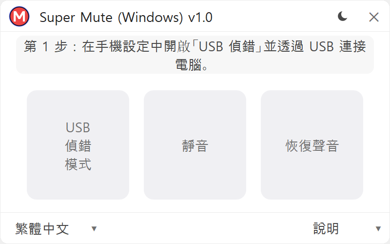
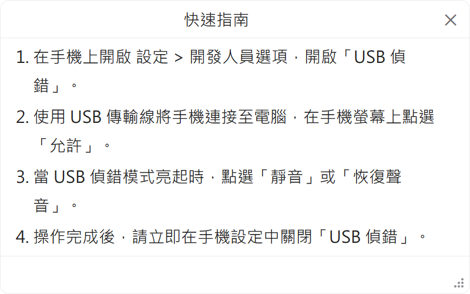

  <a href="README.md">한국어</a> | <a href="README_en.md">English</a> | <a href="README_jap.md">日本語</a> | <a href="README_zh_cn.md">简体中文</a> | <b>繁體中文</b>

# Super Mute (Windows) — 超級靜音 Windows 版

  <picture>
    <source media="(prefers-color-scheme: dark)" srcset="logo/minagy_monogram_coral.png">
    <source media="(prefers-color-scheme: light)" srcset="logo/minagy_monogram.png">
    
  </picture>

  <b>三星 Galaxy 相機快門音 1 鍵靜音 Windows 免安裝工具</b> 
  Built by <b>Minagy Labs</b>

  
  
  
  
  
  
  
  
  

  
  &nbsp;&nbsp;
  

---

## 簡介

**Super Mute (Windows)** 是一款免安裝便攜桌面工具，專為安全關閉三星 Galaxy 智慧型手機（如韓版、日版等受當地法規約束的機型）中強制啟用的相機快門音而設計。

* **保持原生相機完整畫質**: 不同於螢幕錄影或截圖類的低畫質靜音相機 App，本工具直接作用於三星原生相機，完美保留完整感光元件畫質、夜景模式、光學長焦變焦及 HDR。
* **全面相容 Android 各版本**: 有別於因 Android 14 權限收緊而失效的舊工具（如 SetEdit 等），本工具不受內部系統權限限制影響，全面支援從 Android 7.0 (Nougat) 至最新的 Android 16 (One UI 8.5) 以及即將推出的 One UI 9 旗艦機型。
* **Knox 狀態完好 (`0x0`)**: 無需 Root 或刷寫自訂韌體，絕不觸發或熔斷 Knox 計數器，Samsung Pay、Samsung Wallet、Samsung Pass、安全資料夾及各類行動網銀 App 均正常運作。
* **震動/靜音模式聯動**: 在一般響鈴模式下保留快門聲音，**僅在手機設定為震動或靜音模式時，相機快門音完全靜音**。

---

## 下載

| 檔案名稱 | 支援系統 | 檔案大小 | 類型 | 下載連結 |
| :--- | :--- | :---: | :---: | :--- |
| **`SuperMute.exe`** | Windows 10 / 11 (64-bit) | ~55 MB | 單檔案免安裝便攜版 | [**下載最新發行版本**](https://github.com/minagylabs/SuperMuteWindows/releases/latest) |

> **單檔案免安裝**: 下載後按兩下即可直接執行。程式已內建通訊模組及專用字型，不寫入任何 Windows 註冊表殘留項目。

---

## 安全性與「10 秒規則」

為了保障您的裝置隱私與資訊安全，請遵循以下安全操作指引：

1. **PC 事前防毒掃描**:
   - 在連接手機前，請使用 Windows Defender 或受信任的防毒軟體對電腦進行全面掃描。
2. **1 鍵極簡操作**:
   - 使用 USB 傳輸線連接手機，在手機螢幕上點選授權偵錯後，點選 **［靜音］** 按鈕。
3. **嚴格遵守 10 秒安全規則**:
   * 當狀態卡片顯示為 `快門音: 已靜音 (0) ✓` 時，請立即拔除 USB 傳輸線。
   * 開啟手機 **設定 → 開發人員選項**，並立即 **關閉「USB 偵錯」**。
4. **最小權限與隱私保護**:
   * 本程式僅查詢與修改相機快門音這一項系統設定值。
   * 絕不會在手機中安裝任何 APK、背景常駐服務或修改過的系統檔案。
   * 程式結束時將立即安全關閉所有開放的通訊連接埠與背景工作階段。

---

## 使用步驟指南

1. 在手機上開啟 **設定 → 開發人員選項**，將 **「USB 偵錯」** 開啟。  
   *(若未顯示開發人員選項：請前往 **設定 → 關於手機 → 軟體資訊**，連續快速點選 **「版本號碼」** 7 次)*。
2. 使用 USB 傳輸線將手機連接至電腦。
3. 當手機螢幕彈出 **「允許 USB 偵錯嗎？」** 提示時，點選 **［允許］**。
4. 在電腦上執行 `SuperMute.exe`，當 **［靜音］** 按鈕亮起時點選它。
5. 確認狀態卡片顯示為：`快門音: 已靜音 (0) ✓`。
6. 拔除 USB 傳輸線，並在手機設定中立即 **關閉「USB 偵錯」**。

---

## 支援機型列表

| 裝置系列 | 目標系統 | 支援狀態 | 靜音後效果 |
| :--- | :--- | :---: | :--- |
| **Galaxy S 系列** (S7 以後全系列機型) | One UI 1.0 ~ 8.5 / 9+ (Android 7 ~ 16+) | **支援 ✓** | 手機處於震動或靜音模式時原生相機完全靜音 |
| **Galaxy Z 摺疊螢幕系列** (Fold / Flip 全系列機型) | One UI 1.1 ~ 8.5 / 9+ (Android 9 ~ 16+) | **支援 ✓** | 封面螢幕與內頁主螢幕相機均可完全靜音 |
| **Galaxy Note 系列** (Note 8 ~ Note 20 系列) | One UI 1.0 ~ 4.1 (Android 7 ~ 12) | **支援 ✓** | 震動或靜音模式下完全靜音 |
| **Galaxy A / M / Quantum 系列** (A10 ~ A55, M 等系列) | One UI / One UI Core (Android 7 ~ 16+) | **支援 ✓** | 震動或靜音模式下完全靜音 |
| **Google Pixel / 小米 / iPhone** | 非三星系統 | 不支援 | 由於未使用三星原生系統設定架構，因此不提供支援。 |

---

## 常見問題 (FAQ)

<b>Q: 最新的 Android 16 以及 One UI 8.5 / 9 也能正常使用嗎？（相較於其他方式的優勢）</b>

 
<b>是的，無論 Android 或 One UI 版本為何，全面支援所有 Galaxy 裝置。</b> 
以往的裝置端設定修改軟體（如 SetEdit 等）因 Android 14 以後的系統權限收緊而被徹底封鎖。而 <b>Super Mute (Windows)</b> 不受此類系統權限限制影響，從較早的 Android 7.0 (Nougat) 手機到最新的 Android 16 (One UI 8.5) 以及即將推出的 One UI 9 旗艦裝置均能穩定運作。

<b>Q: 手機每次重新開機後都需要重新設定嗎？</b>

 
<b>不需要。</b> 即使正常重新開機或電池耗盡關機，靜音設定依然永久保留。僅在每年進行 Android 大版本升級（例如 One UI 8.5 升級至 One UI 9）或恢復原廠設定後，才需要重新連接設定一次。

<b>Q: 連接傳輸線後一直顯示「等待連接裝置...」，無法辨識怎麼辦？</b>

 
請依序檢查以下項目：
1. 確認所使用的 USB 傳輸線支援<b>資料傳輸</b>，而非僅供充電的線材。
2. 確認手機<b>開發人員選項</b>中的<b>「USB 偵錯」</b>已開啟。
3. 喚醒手機螢幕，確認是否有<b>「允許 USB 偵錯嗎？」</b>的彈出視窗，並點選<b>［允許］</b>。
4. 若電腦缺少三星 USB 驅動程式，Windows Update 通常會自動安裝；亦可安裝 Samsung Smart Switch 或官方 Samsung Android USB 驅動程式。

<b>Q: 為什麼首次執行時 Windows SmartScreen 或防毒軟體會彈出警告？</b>

 
<code>SuperMute.exe</code> 是一款全新的開源便攜軟體，內建了用於與手機通訊的底層元件。由於本軟體完全免費開源，未購買價格昂貴的高級商業企業代碼簽名憑證（EV 憑證），因此新版本釋出初期可能會觸發 Windows 的信譽篩選提示。程式內絕對不含任何惡意程式碼，請安心使用。

---

## 贊助 Minagy Labs

Super Mute (Windows) 是由 **Minagy Labs** 維護的免費開源專案，無任何廣告及付費限制。

若此工具在日常工作與學習中為您帶來便利，歡迎贊助並支持我們的持續開發：

  

* **Buy Me a Coffee**: [buymeacoffee.com/minagylabs](https://buymeacoffee.com/minagylabs)
* **Instagram**: [@minagylabs](https://www.instagram.com/minagylabs/)
* **GitHub Issues**: [minagylabs/SuperMuteWindows/issues](https://github.com/minagylabs/SuperMuteWindows/issues)
* **Email**: `minagylabs@gmail.com`

---

## 授權條款與版權

* **Software**: Released under the [MIT License](LICENSE).
* **Copyright**: Copyright © 2026 **Minagy Labs**. All rights reserved.
